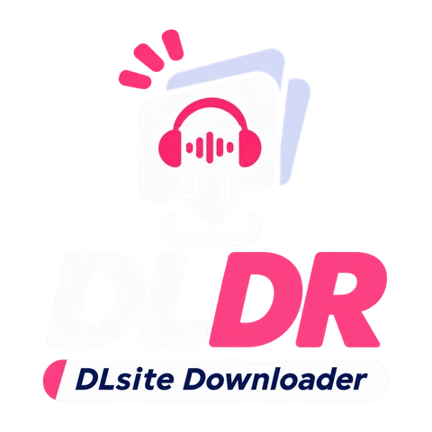
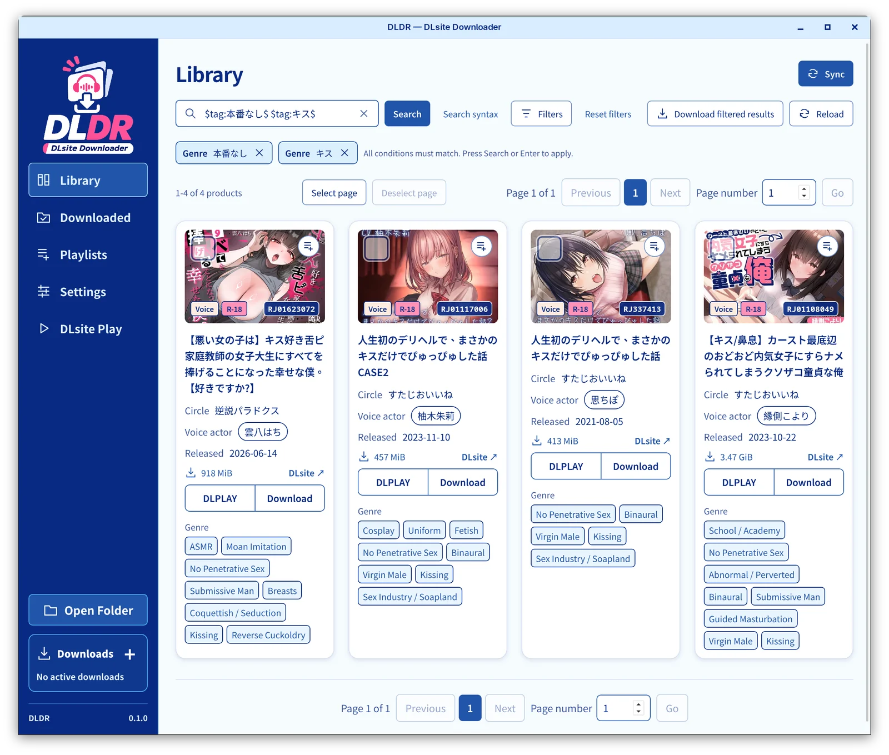
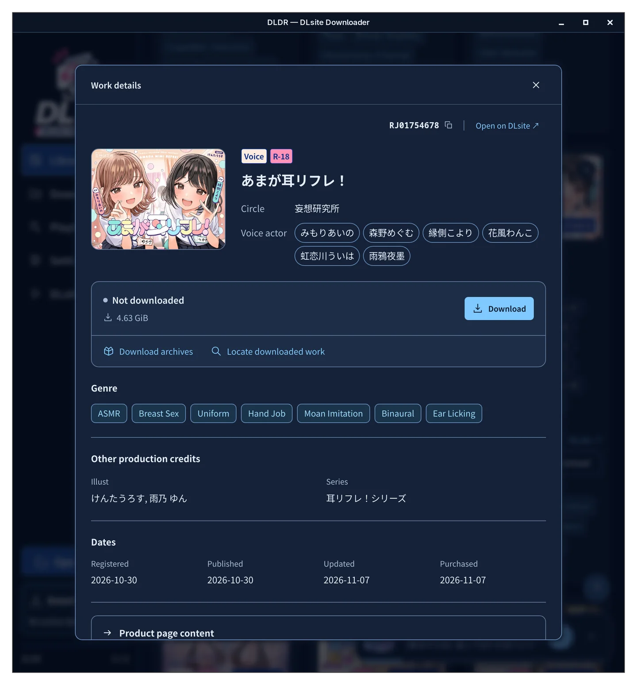
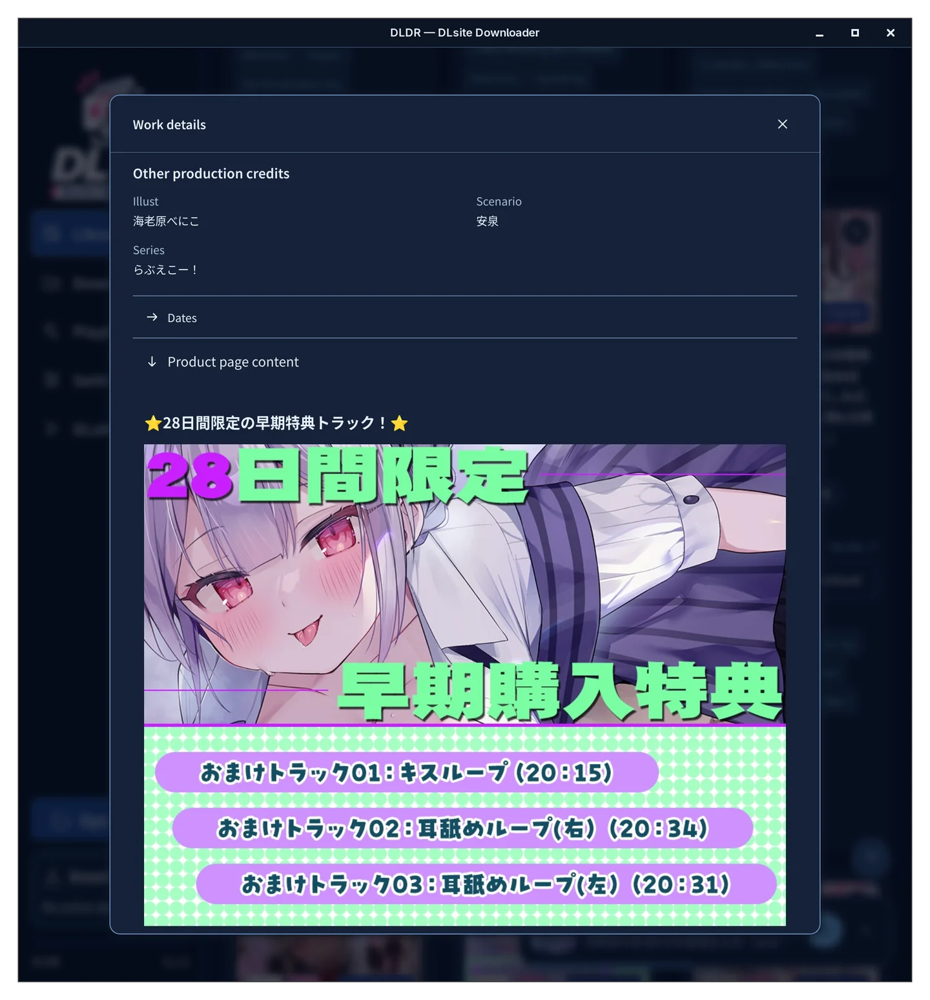
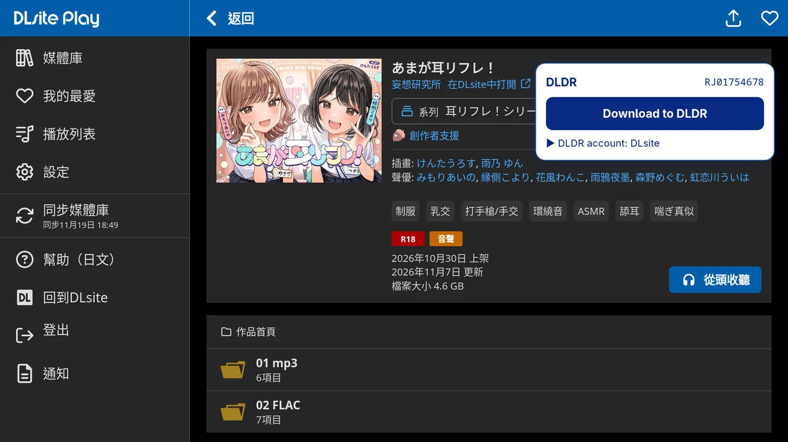

<p align="center">
  
</p>

# DLDR — DLsite Downloader

Search, download and play your purchased DLsite works.

**[Download](https://github.com/ribeye0/dldr/releases/latest)** · English / [中文](README.zh-TW.md)



## Features

- A cover-based library with circle, voice actor, genre and release-date metadata.
- Read the original DLsite product description directly in work details.
- Batch downloads across pages, up to four parallel works, pause/resume and a shared speed limit.
- Built-in audio player with automatic VTT matching and a synchronized script view. Play tracks directly from supported archives.
- DLsite Play integration: listen online, then queue downloads from the official player.
- Free-text search, precise filters, autocomplete and named playlists.
- In-app updates for Linux AppImage and Windows, including portable copies.
- English, Japanese, Traditional Chinese and Simplified Chinese interfaces and genre names. Light and dark themes.

Built with Rust, Tauri and Svelte. The GUI and CLI share the same library and settings.

## A closer look

Browse work details, read the original product description and queue downloads from DLsite Play.

| Work details | Product page content |
| --- | --- |
| See the circle, voice cast, genres and file size, with download actions in one place. | Expand **Product page content** to view the original description and images inside DLDR. |
| [](docs/images/work-detail.webp) | [](docs/images/product-page.webp) |

**From DLsite Play to your download queue**

Listen in the official player, then click **Download to DLDR** on a supported work page to queue an owned, synced work.

[](docs/images/dlsite-play.webp)

## Install

Choose a package from [Releases](https://github.com/ribeye0/dldr/releases/latest). `VERSION` in the filenames is the release version:

| System | Package | Start |
| --- | --- | --- |
| Windows 11 x64 | `DLDR_VERSION_x64-setup.exe` | Run the installer. |
| Windows 11 x64, portable | `DLDR_VERSION_windows_x64.zip` | Extract the entire ZIP and open `DLDR/DLDR.Desktop.exe`. Keep the accompanying files. |
| Arch Linux x86_64 | `dldr-VERSION-1-x86_64.pkg.tar.zst` | Install with `sudo pacman -U FILE.pkg.tar.zst`; run `dldr-gui`. |
| Linux x86_64, glibc 2.39+ | `DLDR_VERSION_amd64.AppImage` | Make it executable, then open it. |

For example, on Linux:

```sh
chmod +x DLDR_0.1.3_amd64.AppImage
./DLDR_0.1.3_amd64.AppImage
```

Use the version you downloaded. If FUSE is unavailable, add `--appimage-extract-and-run`.
Windows builds are unsigned; the portable ZIP needs WebView2, which the installer can install if missing.

To update, open **Settings → About & updates → Check for updates**, then choose **Update and restart**. Portable copies stay portable; settings and works remain in place. Finish or pause downloads first. Older releases without this button need one manual upgrade. Update the Arch package with `pacman -U`.

## First launch

1. Follow the setup wizard to add your DLsite account and complete any verification.
2. Sync your purchases. Syncing updates the library; it does not download works.
3. Choose the library folder. The default is `dldr/` inside your system Downloads folder, with temporary downloads in `dldr/.staging/`.

Click **Sync** after buying new works. Account and preference settings are grouped under **Settings**:

| Tab | Options |
| --- | --- |
| General | Interface language, theme and title language (follow the interface or set a custom order). |
| Download settings | Folders, parallel downloads, speed limit and archive handling. |
| Accounts | DLsite account and login settings. |

## Usage

### Browse and search

Click a cover or title for work details. Click the work ID on a cover to copy it; **DLsite ↗** opens the product page.

Enter a title, circle, voice actor or genre, then press **Enter** or **Search**. Type `$` for syntax hints and autocomplete, or click a circle, voice actor or genre on a card to add a condition. Search runs against your synced library.

| Query | Meaning |
| --- | --- |
| `"Cuckoldry (Netorare)"` or `"Childhood Friend"` | Search text in cached metadata. |
| `$circle:バイコーンの森$` | Match a circle name. |
| `$va:小花衣こっこ$` | Match a voice actor. |
| `$tag:Childhood Friend$` | Include a genre. |
| `$-tag:Cuckoldry (Netorare)$` | Exclude a genre. |

Separate conditions with spaces; all must match. For example: `$va:小花衣こっこ$ $tag:ASMR$`. Genre names and aliases in all four languages are searchable.

### Download

- One work: click **Download** on its card.
- Several works: check them and choose **Download selected**, then confirm the size review. Selection carries across pages; Shift-click selects a range.
- Matching works: choose **Download filtered results**, then review the size to queue all matching works.

Reported sizes are estimates; leave space for temporary archives and extracted files.

The lower-left **Downloads** panel shows the queue, overall and per-work progress, speed and pause/resume controls. After a restart, unfinished downloads are kept until you resume them.

By default, DLDR extracts supported archives and deletes them only after successful extraction. **Keep archives** saves the archives without extracting them; this setting applies to new downloads.

**Open Folder** opens the library root; a completed card's **Open directory** opens that work's folder.

### Listen and organize

In **Downloaded**, click a card's blank area to open the bottom-right player, then choose a track. Expand it for the track list, script and playback settings; drag the top handle down to collapse it without stopping playback.

Subtitles are matched by filename: `foo.wav.vtt` pairs with `foo.wav`. You can also choose a VTT file from the player's subtitle list and adjust its timing offset. The current line is centered and highlighted in the script view. Turn off **Auto-follow playback** above the script to browse freely; your choice is remembered.

The upper-right playlist icon toggles a work in your default playlist, even before downloading. Right-click to choose another playlist. Create and rename lists from **Playlists**.

### DLsite Play

Click **DLPLAY** to open the official player in a separate window. Sign in with your DLsite/viviON ID and password; social sign-in is not supported. This session is separate from DLDR's download login.

On a supported work page, **Download to DLDR** adds the owned, synced work to your queue. Online playback needs a connection, and official website changes may affect this integration.

## CLI

The Windows ZIP includes `dldr.exe`. In PowerShell, open the extracted `DLDR` folder and use `.\dldr.exe` in place of `dldr` below.

The Arch package includes `dldr`. On other Linux systems, the AppImage is the desktop application. Build the CLI separately with `cargo build --release -p dldr-cli`, then put `target/release/dldr` on your PATH.

```sh
dldr login                                      # Interactive login and library sync
dldr sync                                       # Refresh purchases
dldr search '$va:小花衣こっこ$'                   # Search the local library
dldr RJ01760323                                 # Download one work
dldr RJ01760323 RJ01729125 -j 2 --limit-rate 5M  # Two works, 5 MiB/s total
dldr status                                     # Saved queue state
dldr resume                                     # Resume paused or failed downloads
dldr open RJ01760323                            # Open a downloaded folder
dldr --help
```

Close the GUI before CLI login, logout, sync, download or resume. Read-only search and status can coexist with it. Use single quotes around `$…$` queries to prevent shell expansion. See [CLI usage](docs/dldr.md) for all commands and options.

## Data and settings

| System | Profile directory |
| --- | --- |
| Linux | `~/.config/dldr/`, or `$XDG_CONFIG_HOME/dldr/` when set |
| Windows | `%APPDATA%\dldr\` |

The profile contains `dldr.sqlite` (library, settings, playlists and queue), `credentials/vault.json` (login credentials), `player-history.json`, logs and WebView data. Credentials are stored locally and are **not encrypted**. Keep this directory private.
Downloaded works live in the library folder you selected, separately from the profile. The portable Windows build uses the same profile location as the installer.

Close DLDR before copying the profile. To start with fresh settings, rename this directory; works stored separately in your library folder remain in place.

Use **Settings → General → Library maintenance** to export/import library data or verify downloaded folders. These backups do not include media or login credentials.

## Report a problem

Use **Settings → Logs** to inspect and export the relevant operation. When opening an [issue](https://github.com/ribeye0/dldr/issues), include your OS, DLDR version, work ID, reproduction steps and relevant logs.

## Development

Use Rust 1.100.0, Node.js 22 and pnpm 12.3.4, plus the platform's native build dependencies listed in the [build guide](docs/releasing.md#build-and-verify).

```sh
pnpm install --frozen-lockfile
pnpm tauri dev
```

Source layout: [architecture](docs/architecture.md). Dependency notices and sources: [third-party details](docs/THIRD-PARTY.md).

Thanks to [AcrylicShrimp/dlsite-manager](https://github.com/AcrylicShrimp/dlsite-manager) for sharing the approach to downloading DLsite works.

[MIT](LICENSE.md)
