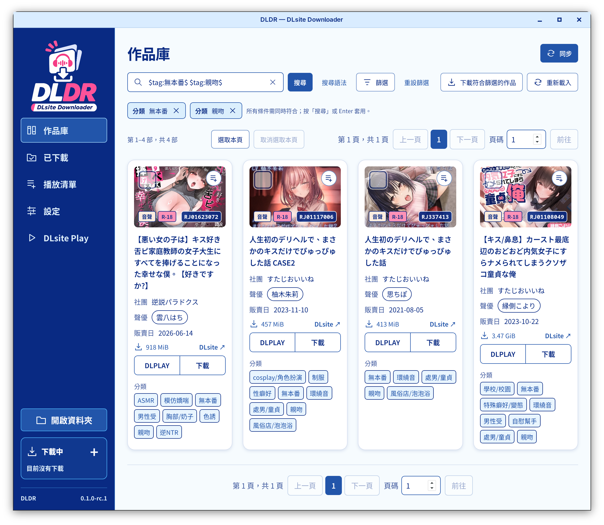

<p align="center">
  
</p>

# DLDR — DLsite Downloader

搜尋、下載與播放你已購買的 DLsite 作品。

**[下載](https://github.com/ribeye0/dldr/releases/latest)** · [English](README.md) / 中文



## 特色

- 以封面瀏覽作品，顯示社團、聲優、分類與販賣日。
- 在作品詳細資訊內，直接查看 DLsite 商品頁的作品介紹。
- 跨頁批次勾選，最多同時下載四部作品，支援暫停、續傳與整體限速。
- 內建音訊播放器，自動配對 VTT 字幕，以台本顯示同步字幕；支援直接播放壓縮檔內的音軌。
- 整合 DLsite Play，先線上聆聽，再從官方播放器加入下載佇列。
- 純文字搜尋、精準條件、自動補全，以及可命名的播放清單。
- Linux AppImage 與 Windows 支援程式內更新，免安裝版維持免安裝形式。
- 繁體中文、簡體中文、日文、英文介面與分類名稱，提供淺色、深色主題。

使用 Rust、Tauri 與 Svelte 開發。圖形介面與 CLI 共用作品庫和設定。

## 安裝

從 [Releases](https://github.com/ribeye0/dldr/releases/latest) 選擇對應版本，檔名中的 `VERSION` 為版本號：

| 系統 | 檔案 | 啟動方式 |
| --- | --- | --- |
| Windows 11 x64 | `DLDR_VERSION_x64-setup.exe` | 執行安裝程式。 |
| Windows 11 x64，免安裝 | `DLDR_VERSION_windows_x64.zip` | 完整解壓縮後，開啟 `DLDR/DLDR.Desktop.exe`，請保留隨附檔案。 |
| Arch Linux x86_64 | `dldr-VERSION-1-x86_64.pkg.tar.zst` | 用 `sudo pacman -U 檔案.pkg.tar.zst` 安裝，以 `dldr-gui` 啟動。 |
| Linux x86_64，glibc 2.39+ | `DLDR_VERSION_amd64.AppImage` | 加上執行權限後開啟。 |

Linux 啟動範例：

```sh
chmod +x DLDR_0.1.2_amd64.AppImage
./DLDR_0.1.2_amd64.AppImage
```

請使用實際下載的版本檔名。若系統無法使用 FUSE，可加上 `--appimage-extract-and-run` 啟動。
Windows 版本尚未簽署；免安裝版需要 WebView2，安裝版會在缺少時協助安裝。

更新時到「設定 → 關於與更新 → 檢查更新」，再選擇「更新並重新啟動」。免安裝版會維持免安裝形式，設定與作品都會保留；請先完成或暫停下載。沒有此功能的舊版需先手動升級一次。Arch 套件請用 `pacman -U` 更新。

## 首次使用

1. 依引導設定 DLsite 帳號，並完成登入驗證。
2. 同步已購作品。同步只更新作品庫，不會自動下載作品。
3. 選擇作品庫目錄。預設為系統「下載」目錄下的 `dldr/`，暫存放在 `dldr/.staging/`。

購買新作品後，按「同步」更新作品庫。帳號與偏好設定集中在「設定」：

| 分頁 | 可調整的項目 |
| --- | --- |
| 一般 | 介面語言、主題、作品標題語言（跟隨介面或自訂順序）。 |
| 下載設定 | 存放目錄、平行下載數、限速、壓縮檔處理方式。 |
| 帳號 | DLsite 帳號與登入設定。 |

## 操作方式

### 瀏覽與搜尋

點擊封面或作品名稱可開啟詳細資訊；點擊封面上的作品編號即可複製，「DLsite ↗」則開啟商品頁。

在搜尋框輸入作品名、社團、聲優或分類，按 Enter 或「搜尋」套用。輸入 `$` 可查看語法提示與自動補全，也可點擊卡片上的社團、聲優或分類加入條件。搜尋範圍為已同步的作品庫。

| 搜尋內容 | 用途 |
| --- | --- |
| `NTR` 或 `青梅竹馬` | 搜尋已同步資料中的文字。 |
| `$circle:バイコーンの森$` | 指定社團。 |
| `$va:小花衣こっこ$` | 指定聲優。 |
| `$tag:ASMR$` | 包含指定分類。 |
| `$-tag:ASMR$` | 排除指定分類。 |

條件之間用空白分隔，必須同時符合。例如：`$va:小花衣こっこ$ $tag:ASMR$`。分類可使用四種語言的名稱與已收錄別名。

### 下載

- 單部下載：點擊卡片上的「下載」。
- 批次下載：勾選作品後按「下載所選作品」，確認容量後加入佇列。勾選會跨頁保留，Shift 點擊可選取一段範圍。
- 依條件下載：按「下載符合篩選的作品」，確認容量後加入所有符合條件的作品。

顯示的容量為估計值，請另外預留下載暫存與解壓縮所需空間。

左下角「下載中」可查看佇列、整體與各作品的進度、速率，並操作暫停與續傳。重新啟動程式後，未完成的下載會保留，等待你繼續。

預設下載後自動解壓縮，成功後才刪除可辨識的壓縮檔。在下載設定選擇「保留壓縮檔」，則只保留壓縮檔，不自動解壓縮；此選項套用於新加入的下載。

左側「開啟資料夾」開啟作品庫根目錄，已下載卡片上的「打開目錄」則開啟該作品的資料夾。

### 播放與整理

在「已下載」點擊卡片的空白區域，即可開啟右下角播放器，再選擇音軌。展開後可切換音軌、台本與播放設定；向下拖曳頂部橫條即可折疊，播放不會中斷。

字幕會依檔名自動配對，例如 `foo.wav` 對應 `foo.wav.vtt`。也可在播放器的字幕清單手動選擇，並調整時間偏移。台本會將正在播放的字幕置中並高亮。

卡片右上角的播放清單圖示，可將作品加入或移出預設清單，未下載的作品也能收藏；按右鍵可選擇其他清單。到左側「播放清單」建立或重新命名清單。

### DLsite Play

點擊「DLPLAY」，以獨立視窗開啟官方播放器。請使用 DLsite／viviON ID 與密碼登入，目前不支援社群帳號登入；此視窗的登入狀態與 DLDR 的下載帳號分開保存。

在支援的作品頁點「下載至 DLDR」，即可將已持有、已同步的作品加入佇列。線上播放需要網路，官方網站改版可能影響此整合。

## CLI

Windows 免安裝 ZIP 已包含 `dldr.exe`。在 PowerShell 中進入解壓縮後的 `DLDR` 資料夾，將下列指令的 `dldr` 改為 `.\dldr.exe`。

Arch 套件已包含 `dldr`。其他 Linux 系統的 AppImage 為桌面程式，CLI 需另外建置：執行 `cargo build --release -p dldr-cli`，再將 `target/release/dldr` 放入 PATH。

```sh
dldr login                                      # 互動式登入並同步作品
dldr sync                                       # 更新購買清單
dldr search '$va:小花衣こっこ$'                   # 搜尋本機作品庫
dldr RJ01760323                                 # 下載單部作品
dldr RJ01760323 RJ01729125 -j 2 --limit-rate 5M  # 同時下載兩部，整體限速 5 MiB/s
dldr status                                     # 查看已儲存的佇列狀態
dldr resume                                     # 續傳暫停或失敗的下載
dldr open RJ01760323                            # 開啟已下載作品的資料夾
dldr --help
```

登入、登出、同步、下載或續傳前，請先關閉圖形介面；唯讀搜尋與狀態查詢可同時使用。搜尋條件中的 `$…$` 請用單引號包住，避免被 shell 展開。完整指令與選項見 [CLI 說明](docs/dldr.md)。

## 資料與設定

| 系統 | 設定資料目錄 |
| --- | --- |
| Linux | `~/.config/dldr/`，有設定 `XDG_CONFIG_HOME` 時為 `$XDG_CONFIG_HOME/dldr/` |
| Windows | `%APPDATA%\dldr\` |

目錄內包含 `dldr.sqlite`（作品庫、設定、播放清單與佇列）、`credentials/vault.json`（登入憑證）、`player-history.json`、日誌與 WebView 資料。登入憑證儲存在本機，**未加密**，請妥善保管此目錄。
作品檔案另外存於你選擇的作品庫目錄。Windows 免安裝版與安裝版共用上述設定路徑。

複製設定資料前請先關閉 DLDR。若想重新設定，可將此目錄改名；另外存放的作品檔案會保留。

「設定 → 一般 → 作品庫維護」可匯出／匯入作品庫資料，或核對已下載資料夾。備份不包含作品檔案或登入憑證。

## 問題回報

到「設定 → Logs」查看並匯出相關操作。回報至 [Issues](https://github.com/ribeye0/dldr/issues) 時，請附上系統、DLDR 版本、作品編號、重現步驟與相關日誌。

## 開發

使用 Rust 1.100.0、Node.js 22、pnpm 12.3.4；各平台的原生建置依賴見[建置說明](docs/releasing.md#build-and-verify)。

```sh
pnpm install --frozen-lockfile
pnpm tauri dev
```

[專案結構](docs/architecture.md) · [第三方元件與原始碼](docs/THIRD-PARTY.md)

感謝 [AcrylicShrimp/dlsite-manager](https://github.com/AcrylicShrimp/dlsite-manager) 提供下載 DLsite 作品的方法。

[MIT](LICENSE.md)
